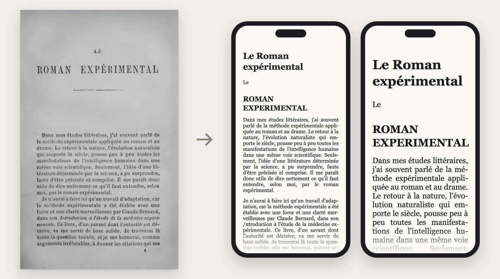
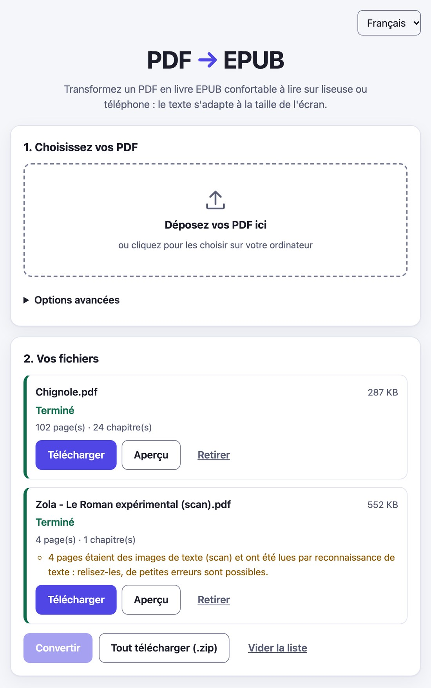
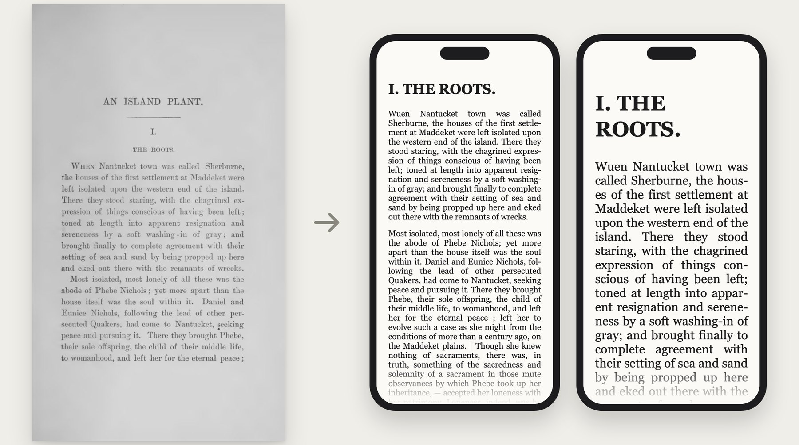
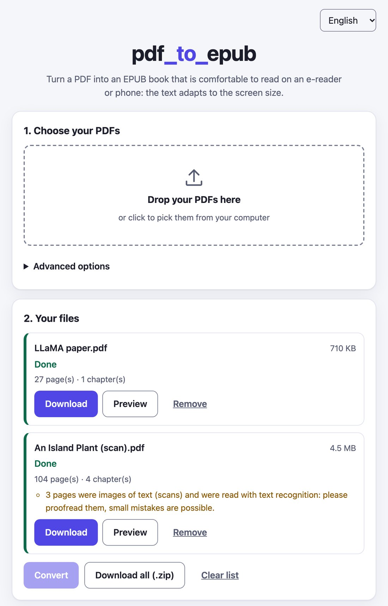

# pdftoepub

[](LICENSE)

**[Français](#français)** · **[English](#english)**

---

## Français

**Transformez un PDF en vrai livre numérique (EPUB) qui s'adapte à tous les écrans. Gratuit, privé, sur votre
ordinateur.**



*À gauche, une page scannée (Zola, 1902). À droite, le même texte dans l'EPUB produit, sur un téléphone en petite puis
en grande police. Résultat brut, sans retouche : les petites erreurs de reconnaissance de texte restent visibles.*

Le livre obtenu contient du vrai texte (titres, paragraphes, listes, tableaux, images, notes) et non des images de
pages : il se recompose selon la taille de police choisie sur la liseuse ou le téléphone. Les pages scannées sont lues
par la reconnaissance de texte intégrée (OCR, français et anglais). Rien n'est envoyé à un service extérieur.

### Pour commencer

1. **Téléchargez** le fichier correspondant à votre ordinateur dans le tableau [Télécharger](#télécharger)
   (Mac : `.dmg` ; Windows : `.exe` ; Linux : le fichier `linux`).
2. **Mac :** ouvrez le `.dmg`, glissez `pdftoepub.app` dans Applications, puis double-cliquez dessus.
   **Windows :** double-cliquez sur le `.exe`. Rien d'autre à installer (ni Python, ni OCR).
3. Au premier lancement, le système affiche un avertissement car l'application n'est pas signée : voir
   [Premier lancement](#premier-lancement-dune-version-non-signée) (une seule fois).
4. Votre navigateur s'ouvre : déposez vos PDF, cliquez **Convertir**, puis **Télécharger**. Tout reste sur votre
   ordinateur. Pour arrêter, cliquez **Quitter** dans la page (sinon l'application s'arrête seule après 15 minutes
   sans utilisation).

<p align="center"></p>

### Télécharger

Depuis la [dernière version](https://github.com/ember169/pdf_to_epub/releases/latest). Chaque fichier inclut l'OCR
(Tesseract avec les données française et anglaise) ; leurs empreintes sont dans `SHA256SUMS`.

| Système | Fichier | Taille | Minimum |
|---|---|---|---|
| Mac avec puce Apple (M1 et suivantes) | `pdftoepub-macos-arm64.dmg` | 40 Mo | macOS 12 Monterey |
| Mac avec processeur Intel | `pdftoepub-macos-x86_64.dmg` | 42 Mo | macOS 12 Monterey |
| Mac, ligne de commande seule | `pdftoepub-macos-arm64` / `pdftoepub-macos-x86_64` | 37 / 38 Mo | macOS 12 |
| Windows | `pdftoepub-windows-x86_64.exe` | 88 Mo | Windows 64 bits (testé sous Wine uniquement) |
| Linux (PC) | `pdftoepub-linux-x86_64` | 73 Mo | glibc 2.31 (Debian 11, Ubuntu 20.04 ou plus récent) |
| Linux (ARM) | `pdftoepub-linux-arm64` | 72 Mo | idem |

Il n'y a pas de fichier Mac « universel » : choisissez selon la puce ( menu → À propos de ce Mac). La version
minimale de macOS est mesurée sur chaque binaire au moment du build (`packaging/audit_minos.sh`) ; elle n'a pas été
essayée sur un vrai Mac sous macOS 12.

### Premier lancement d'une version non signée

Les versions publiées ne sont **pas signées** par un certificat Apple ou Microsoft (c'est payant chaque année) : le
système avertit une seule fois. C'est normal ; ensuite, l'application s'ouvre directement.

**macOS 15 Sequoia et plus récent** (l'ancien clic droit → Ouvrir ne fonctionne plus) :

1. Double-cliquez sur `pdftoepub.app`. macOS affiche *« pdftoepub » n'a pas été ouvert*. Cliquez **Terminé** (pas
   *Placer dans la corbeille*).
2. Ouvrez **Réglages Système → Confidentialité et sécurité**, descendez jusqu'à *Sécurité* : à côté de
   *« pdftoepub » a été bloqué…*, cliquez **Ouvrir quand même**, puis confirmez avec **Ouvrir quand même** et votre mot
   de passe ou Touch ID.
3. Désormais, un double-clic suffit.

**macOS 12 à 14 :** clic droit (ou Contrôle-clic) sur `pdftoepub.app` → **Ouvrir** → **Ouvrir**.

**Windows :** à l'écran *Windows a protégé votre ordinateur*, cliquez **Informations complémentaires**, puis
**Exécuter quand même**.

**Fichiers en ligne de commande** (`pdftoepub-macos-*`) : retirez une fois la quarantaine de téléchargement dans le
Terminal :
`xattr -d com.apple.quarantine pdftoepub-macos-arm64 && chmod +x pdftoepub-macos-arm64`
(pour l'application : `xattr -dr com.apple.quarantine /Applications/pdftoepub.app`).

(Les libellés des fenêtres correspondent aux versions actuelles de macOS et Windows et peuvent varier légèrement.)

### Ligne de commande

Chaque fichier téléchargé est aussi un outil en ligne de commande (sur macOS, l'exécutable de l'application est
`/Applications/pdftoepub.app/Contents/MacOS/pdftoepub`) :

```bash
./pdftoepub-linux-x86_64 livre.pdf -o livre.epub
./pdftoepub-linux-x86_64 serve --open        # page web sur http://127.0.0.1:8000
./pdftoepub-linux-x86_64                     # sans argument : lance la page web et ouvre le navigateur
```

| Option | Par défaut | Rôle |
|---|---|---|
| `--title`, `--author` | métadonnées du PDF | Remplacer le titre ou l'auteur |
| `--language` | détectée | Code BCP 47, par exemple `fr` |
| `--ocr` | `auto` | `auto` (pages sans texte), `off`, `force` |
| `--ocr-langs` | `fra+eng` | Langues Tesseract |
| `--keep-headers-footers` | non | Garder les en-têtes, pieds de page et numéros de page |
| `--no-columns` | non | Désactiver l'ordre de lecture en colonnes |
| `--no-images` | non | Ne pas inclure les images |
| `--timeout`, `--max-mem`, `--max-pages` | aucune | Arrêter les conversions trop longues, trop gourmandes en mémoire ou trop volumineuses |

`pdftoepub --help` les liste toutes. La page web propose les mêmes choix sous *Options avancées*.

**OCR :** les binaires embarquent Tesseract (macOS : 5.5.4 compilé depuis les sources ; Windows : 5.4 ; Linux : 4.1)
avec les données `tessdata_fast` française et anglaise (environ 5 Mo ; un peu moins précises sur les mauvais scans que
`tessdata_best`, environ 20 Mo). Les pages qui sont des images de texte sont reconnues automatiquement et signalées dans
le résultat pour que vous puissiez les relire. `TESSERACT_CMD` / `TESSDATA_PREFIX`, ou un dossier `tesseract/` à côté de
l'exécutable, remplacent la copie intégrée.

**Lanceur macOS :** le premier lancement décompresse environ 100 Mo dans `~/Library/Caches/pdftoepub/` (une quinzaine
de secondes, une seule fois, le temps que macOS analyse les nouveaux fichiers) ; ensuite, un PDF de 2 pages se convertit
en 0,3 s. Supprimez ce dossier pour désinstaller.

### Hébergement sur un serveur (Docker)

```bash
docker compose -f deploy/docker-compose.yml up --build
```

Ouvrez <http://localhost:8000>. Le fichier compose publie le port sur **127.0.0.1 uniquement**. Le conteneur tourne en
lecture seule, sans droits root, avec une limite mémoire (`MEM_LIMIT`, 2g par défaut), 256 processus et aucune
capacité système ; les fichiers envoyés et les résultats vivent dans le volume `pdftoepub-data` et sont supprimés après
`JOB_TTL_HOURS`. L'image inclut Tesseract (français, anglais).

**Hébergement public :** définissez `AUTH_TOKEN` (la page le demande alors), gardez le port lié à localhost et placez un
proxy TLS devant : [`deploy/Caddyfile.example`](deploy/Caddyfile.example) (désactive la mise en tampon du flux de
progression, limite la taille des envois). Définissez `ALLOWED_HOSTS` avec votre domaine. Toutes les variables du
serveur (`MAX_UPLOAD_MB`, `MAX_PAGES`, `JOB_TIMEOUT_S`, `JOB_MAX_MEM_MB`, `MAX_CONCURRENT_JOBS`…) sont décrites dans
[`src/pdftoepub/web/README.md`](src/pdftoepub/web/README.md). `GET /healthz` sert aux contrôles de santé.

### Qualité

Mesurée sur 18 PDF du domaine public ou sous licence libre (3 362 pages : romans en français et en anglais, articles
arXiv, un manuel de 1 185 pages, livres de mathématiques, livres scannés d'Internet Archive) ; détails et méthode dans
[`tests/corpus/REPORT.md`](tests/corpus/REPORT.md) :

- **98,3 %** des mots retrouvés (les en-têtes courants et numéros de page sont retirés volontairement) et un score
  d'ordre de lecture de **0,948** (suites de 6 mots dans le bon ordre).
- **0 erreur epubcheck** sur les 18 livres, avec les deux moteurs de lecture PDF.
- Les livres scannés retrouvent leurs chapitres à partir de la mise en page : 7 essais sur 7 dans *Le Roman
  expérimental* de Zola, 3 sur 3 dans *An Island Plant*.
- Livres de mathématiques : les formules en deux dimensions deviennent des images accompagnées de leur texte ; les
  coupures de paragraphe en milieu de phrase dans *Calculus Made Easy* passent de 87 à 47 pour 1 000 paragraphes.

### Limites

- Taille maximale d'envoi : `MAX_UPLOAD_MB` ; les PDF chiffrés (protégés par mot de passe) et les fichiers non PDF sont
  refusés.
- L'analyse de mise en page est heuristique : les mises en page complexes (tableaux imbriqués, magazines, notes en
  marge) peuvent demander une retouche manuelle.
- Mathématiques : pas de MathML. Les formules en deux dimensions deviennent des images (avec la formule en texte
  linéaire comme description) ; les formules sur une ligne, indices, exposants et fractions en ligne (`a/b`) restent
  du texte.
- Livres scannés sans sommaire PDF : les chapitres sont trouvés à partir de la mise en page et d'une table des matières
  imprimée (parties, chapitres numérotés, sections, numéros de page imprimés) ; les titres et le texte gardent une
  partie de leurs erreurs de reconnaissance, et les notes absentes de la couche OCR manquent.
- Notes de fin : reliées à leur appel quand celui-ci est en exposant ; un appel mal reconnu reste sans lien.
- Les figures vectorielles sont converties en images ; la qualité de l'OCR dépend du scan et des langues choisies.
- Un seul processus serveur ; pas de répartition sur plusieurs machines.

### Site web (prévu)

Un site GitHub Pages est prévu à l'adresse <https://ember169.github.io/pdf_to_epub/> : présentation, tableau de
téléchargement, captures d'écran et FAQ sur l'ouverture des applications non signées. Ses sources seront dans `docs/`
(qui contient déjà les illustrations ; la page `index.html` n'existe pas encore) et publiées avec le réglage Pages
« Deploy from a branch » (branche `main`, dossier `/docs`, le seul sous-dossier que ce réglage peut servir), sans
GitHub Actions.

### Publication des versions (build local, sans CI)

Il n'y a pas de CI : tout est construit et testé sur un Mac (Docker pour Linux, Wine dans Docker pour Windows), puis
envoyé.

```bash
packaging/build.sh mac-arm64 mac-x86_64 linux-arm64 linux-x86_64 windows   # tous les binaires dans dist/
packaging/smoke.sh                       # teste chaque binaire en environnement vierge, réécrit dist/SHA256SUMS
packaging/release.sh v0.1.0              # simulation : vérifie dist/, écrit SHA256SUMS, affiche la commande gh
packaging/release.sh v0.1.0 --publish    # crée la version sur GitHub (nécessite `gh auth login`)
```

- macOS nécessite `uv`, cmake et les outils en ligne de commande Xcode. Lancez d'abord une fois
  `packaging/build_tesseract_macos.sh` : il compile Tesseract, Leptonica et libpng depuis des sources épinglées et
  vérifiées (sha256) pour les deux types de puce Mac (macOS 11 et plus).
- Le build Mac Intel tourne sous Rosetta et utilise `packaging/macos-x86_64.lock` ; les builds Mac épinglent
  pypdfium2 5.9.0 (le PDFium plus récent exige macOS 13). Le build échoue si un binaire exige un macOS plus récent que
  12.0.
- Linux est construit sur Debian 11 dans Docker et testé dans des conteneurs vierges `debian:11-slim` et
  `ubuntu:20.04`. Windows est construit et testé sous Wine, jamais sur un vrai Windows ; `packaging/build.ps1` (build
  Windows natif) n'a jamais été lancé.
- Toutes les dépendances sont installées depuis des fichiers verrouillés avec empreintes (`requirements.lock`,
  `packaging/*.lock` ; `packaging/relock.sh` les régénère). Les binaires ne contiennent pas PyMuPDF (le build échoue
  s'il est présent).

#### Signature (prête, pas encore utilisée)

Les versions actuelles ont une signature locale (ad hoc). Les scripts de vraie signature sont prêts et ont été validés
de bout en bout avec des certificats auto-signés jetables ; il ne leur manque que les certificats.

| | Ce qui supprime l'avertissement | Script |
|---|---|---|
| macOS | Certificat **Developer ID Application** (Apple Developer Program, 99 USD/an) + notarisation | `packaging/sign_macos.sh` (appelé par `build.sh` ; runtime renforcé, horodatage, notarisation, agrafage) |
| Windows | Certificat **Authenticode** (OV environ 100 à 300 USD/an ; EV ou Azure Trusted Signing possibles) | `packaging/sign_windows.sh` (osslsigncode, horodatage RFC 3161) |

```bash
xcrun notarytool store-credentials pdftoepub-notary --apple-id vous@example.com --team-id TEAMID   # une fois
APPLE_SIGN_IDENTITY="Developer ID Application: Votre Nom (TEAMID)" APPLE_NOTARY_PROFILE=pdftoepub-notary \
  packaging/build.sh mac-arm64 mac-x86_64
WIN_SIGN_PFX=~/certs/codesign.pfx WIN_SIGN_PASSWORD=... packaging/sign_windows.sh
```

Vérifié avec des certificats auto-signés : macOS `codesign --verify --deep --strict` OK, l'application et l'outil en
ligne de commande signés fonctionnent, OCR compris, sans exception de droits ; Windows `osslsigncode verify` OK et le
`.exe` signé fonctionne sous Wine. La notarisation nécessite des identifiants Apple et n'a pas été testée.

### Développement

```bash
python3.12 -m venv .venv && . .venv/bin/activate
pip install -e ".[dev]"
pdftoepub livre.pdf -o livre.epub        # ligne de commande
pdftoepub serve                          # page web sur le port 8000
pytest                                   # les PDF de test sont générés à la volée (tests/fixtures/make_fixtures.py)
docker build -f deploy/Dockerfile --target test -t pdftoepub-test . && docker run --rm pdftoepub-test   # + epubcheck
python tests/corpus/fetch.py             # corpus de documents réels (téléchargés, vérifiés par sha256)
python tests/corpus/evaluate.py --label moi
```

Depuis une installation à partir des sources, l'OCR nécessite `tesseract` et ses langues
(`brew install tesseract tesseract-lang`, `apt install tesseract-ocr-fra`) ; sans lui, les pages scannées sont
ignorées avec un avertissement. epubcheck 5.4.0 est téléchargé une fois dans `tests/.cache` (vérifié par sha256 ;
`EPUBCHECK_JAR` pour utiliser le vôtre) et ses tests sont ignorés sans `java`. La suite tourne une fois par moteur de
lecture PDF (`PDFTOEPUB_BACKEND` = `pdfminer`, `pymupdf`).

### Licence

MIT (voir [`LICENSE`](LICENSE)). Moteur PDF par défaut : pdfminer.six (MIT) + pypdfium2 (Apache-2.0/BSD-3). Les
binaires embarquent Python (PSF), PDFium, Tesseract (Apache-2.0), Leptonica (BSD-2), libpng et `tessdata_fast`
(Apache-2.0) ; leurs licences figurent dans `THIRD_PARTY_LICENSES` (également inclus dans chaque binaire).

Un moteur optionnel utilise [PyMuPDF](https://pymupdf.readthedocs.io/) (`pip install ".[pymupdf]"`,
`PDFTOEPUB_BACKEND=pymupdf`). PyMuPDF est sous **AGPL-3.0** : une installation qui l'inclut relève de l'AGPL. Les
binaires et l'image Docker ne l'incluent pas.

---

## English

**Turn a PDF into a real e-book (EPUB) that adapts to any screen. Free, private, runs on your own computer.**



*Left: a scanned page (An Island Plant, 1896). Right: the same text in the generated EPUB, on a phone at a small then a
large font size. Raw output, not retouched: small text-recognition mistakes are still visible.*

The output contains real text (headings, paragraphs, lists, tables, images, footnotes), not page pictures, so it
reflows with the reader's font size on an e-reader or a phone. Scanned pages are read with built-in text recognition
(OCR, English and French). Nothing is sent to any external service.

### Getting started

1. **Download** the file for your computer from the [Download](#download) table (Mac: `.dmg`; Windows: `.exe`;
   Linux: the `linux` file).
2. **Mac:** open the `.dmg`, drag `pdftoepub.app` to Applications, double-click it. **Windows:** double-click the
   `.exe`. Nothing else to install (no Python, OCR included).
3. The first launch shows a warning because the app is not signed: see
   [First launch](#first-launch-of-an-unsigned-build) (once only).
4. Your browser opens: drop your PDFs, click **Convert**, then **Download**. Everything stays on your computer. To stop
   it, click **Quit** in the page (it also stops by itself after 15 minutes without use).

<p align="center"></p>

### Download

From the [latest release](https://github.com/ember169/pdf_to_epub/releases/latest). Every file includes OCR
(Tesseract with English and French data) and checks against `SHA256SUMS`.

| System | File | Size | Minimum |
|---|---|---|---|
| Mac with Apple silicon (M1 and later) | `pdftoepub-macos-arm64.dmg` | 40 MB | macOS 12 Monterey |
| Mac with Intel processor | `pdftoepub-macos-x86_64.dmg` | 42 MB | macOS 12 Monterey |
| Mac, command line only | `pdftoepub-macos-arm64` / `pdftoepub-macos-x86_64` | 37 / 38 MB | macOS 12 |
| Windows | `pdftoepub-windows-x86_64.exe` | 88 MB | 64-bit Windows (tested under Wine only) |
| Linux (PC) | `pdftoepub-linux-x86_64` | 73 MB | glibc 2.31 (Debian 11, Ubuntu 20.04 or newer) |
| Linux (ARM) | `pdftoepub-linux-arm64` | 72 MB | same |

There is no single "universal" Mac file: pick by chip ( menu → About This Mac). The minimum macOS is measured on every
binary at build time (`packaging/audit_minos.sh`), not just declared; it was not tried on a real macOS 12 machine.

### First launch of an unsigned build

The builds are **not signed** with an Apple or Microsoft certificate (that costs a yearly fee), so the system warns once.
This is expected; afterwards the app opens normally.

**macOS 15 Sequoia and newer** (the old right-click → Open shortcut no longer works):

1. Double-click `pdftoepub.app`. macOS shows *"pdftoepub" Not Opened*. Click **Done** (not *Move to Trash*).
2. Open **System Settings → Privacy & Security**, scroll down to *Security*: next to *"pdftoepub" was blocked to protect
   your Mac* click **Open Anyway**, confirm with **Open Anyway** and your password or Touch ID.
3. From now on, double-click opens it directly.

**macOS 12–14:** right-click (or Control-click) `pdftoepub.app` → **Open** → **Open**.

**Windows:** SmartScreen shows *Windows protected your PC*. Click **More info**, then **Run anyway**.

**Command-line files** (`pdftoepub-macos-*`): clear the download quarantine once in Terminal:
`xattr -d com.apple.quarantine pdftoepub-macos-arm64 && chmod +x pdftoepub-macos-arm64`
(for the app: `xattr -dr com.apple.quarantine /Applications/pdftoepub.app`).

(Dialog wording is from current macOS and Windows releases and may differ slightly between versions.)

### Command line

Every download is also a command-line tool (on macOS the app's executable is
`/Applications/pdftoepub.app/Contents/MacOS/pdftoepub`):

```bash
./pdftoepub-linux-x86_64 book.pdf -o book.epub
./pdftoepub-linux-x86_64 serve --open        # web page on http://127.0.0.1:8000
./pdftoepub-linux-x86_64                     # no arguments: starts the web page and opens the browser
```

| Option | Default | Meaning |
|---|---|---|
| `--title`, `--author` | from PDF metadata | Override the title or author |
| `--language` | detected | BCP 47 code, e.g. `en` |
| `--ocr` | `auto` | `auto` (pages without text), `off`, `force` |
| `--ocr-langs` | `fra+eng` | Tesseract languages |
| `--keep-headers-footers` | off | Keep running headers/footers and page numbers |
| `--no-columns` | off | Disable multi-column reading order |
| `--no-images` | off | Leave images out |
| `--timeout`, `--max-mem`, `--max-pages` | none | Stop conversions that take too long, too much memory or too many pages |

`pdftoepub --help` lists them all. The web page offers the same choices under *Advanced options*.

**OCR:** the binaries ship Tesseract (macOS: 5.5.4 built from source; Windows: 5.4; Linux: 4.1) with `tessdata_fast`
English and French data (about 5 MB; a bit less accurate on poor scans than `tessdata_best`, about 20 MB). Pages that
are pictures of text are recognised automatically and flagged in the result so you can proofread them.
`TESSERACT_CMD` / `TESSDATA_PREFIX`, or a `tesseract/` folder next to the executable, override the bundled copy.

**macOS launcher:** the first run unpacks about 100 MB into `~/Library/Caches/pdftoepub/` (about 15 s, once, while
macOS scans the new files); after that a 2-page PDF converts in 0.3 s. Delete that folder to uninstall.

### Self-hosting (Docker)

```bash
docker compose -f deploy/docker-compose.yml up --build
```

Open <http://localhost:8000>. The compose file publishes the port on **127.0.0.1 only**. The container runs read-only,
as a non-root user, with a memory limit (`MEM_LIMIT`, default 2g), 256 pids and no capabilities; uploads and results
live in the `pdftoepub-data` volume and are deleted after `JOB_TTL_HOURS`. The image includes Tesseract (English,
French).

**Public hosting:** set `AUTH_TOKEN` (the page then asks for it), keep the localhost port mapping and put a TLS proxy in
front: [`deploy/Caddyfile.example`](deploy/Caddyfile.example) (disables buffering of the progress stream, caps the
upload size). Set `ALLOWED_HOSTS` to your domain. All server variables (`MAX_UPLOAD_MB`, `MAX_PAGES`, `JOB_TIMEOUT_S`,
`JOB_MAX_MEM_MB`, `MAX_CONCURRENT_JOBS`, …) are listed in [`src/pdftoepub/web/README.md`](src/pdftoepub/web/README.md).
`GET /healthz` serves health checks.

### Quality

Measured on 18 public-domain or openly licensed PDFs (3,362 pages: novels in English and French, arXiv papers, a
1,185-page textbook, math books, scanned Internet Archive books); details and method in
[`tests/corpus/REPORT.md`](tests/corpus/REPORT.md):

- **98.3 %** of the words found (running heads and page numbers are removed on purpose) and a reading-order score of
  **0.948** (6-word sequences in the right order).
- **0 epubcheck errors** on all 18 books, with both PDF backends.
- Scanned books get their chapters back from the page layout: 7 of 7 essays in Zola's *Le Roman expérimental*, 3 of 3
  in *An Island Plant*.
- Math books: two-dimensional formulas become pictures with a text alternative; mid-sentence paragraph breaks in
  *Calculus Made Easy* fell from 87 to 47 per 1,000 paragraphs.

### Limits

- Maximum upload size: `MAX_UPLOAD_MB`; encrypted (password-protected) and non-PDF files are rejected.
- Layout analysis is heuristic: complex layouts (nested tables, magazines, marginal notes) may need manual cleanup.
- Math: no MathML. Two-dimensional formulas become pictures (with the formula as linear text for the description);
  one-line formulas, subscripts, superscripts and inline fractions (`a/b`) stay text.
- Scanned books without a PDF outline: chapters are found from the page layout and a printed table of contents (parts,
  numbered chapters, sections, printed page numbers); titles and text keep some recognition mistakes, and notes missing
  from the OCR layer are missing.
- Endnotes are linked to their reference when it is a superscript; a misread reference stays unlinked.
- Vector figures are turned into pictures; OCR quality depends on the scan and the chosen languages.
- One server process; no spreading across several machines.

### Website (planned)

A GitHub Pages site is planned at <https://ember169.github.io/pdf_to_epub/>: presentation, the download table,
screenshots and a FAQ on opening unsigned apps. Its sources will live in `docs/` (which already holds the
illustrations; the `index.html` page does not exist yet) and be published with the Pages "Deploy from a branch" setting
(branch `main`, folder `/docs`, the only sub-folder that setting can serve), with no GitHub Actions.

### Releases (built locally, no CI)

There is no CI: everything is built and tested on a Mac (Docker for Linux, Wine in Docker for Windows), then uploaded.

```bash
packaging/build.sh mac-arm64 mac-x86_64 linux-arm64 linux-x86_64 windows   # all binaries into dist/
packaging/smoke.sh                       # tests every binary in clean environments, rewrites dist/SHA256SUMS
packaging/release.sh v0.1.0              # dry run: checks dist/, writes SHA256SUMS, prints the gh command
packaging/release.sh v0.1.0 --publish    # creates the GitHub release (needs `gh auth login`)
```

- macOS needs `uv`, cmake and the Xcode command line tools. Run `packaging/build_tesseract_macos.sh` once first: it
  builds Tesseract, Leptonica and libpng from pinned, sha256-checked sources for both Mac chips (macOS 11 and newer).
- The Intel Mac build runs under Rosetta and uses `packaging/macos-x86_64.lock`; Mac builds pin pypdfium2 5.9.0
  (newer PDFium needs macOS 13). The build fails if any binary needs a newer macOS than 12.0.
- Linux is built on Debian 11 in Docker and tested in clean `debian:11-slim` and `ubuntu:20.04` containers. Windows is
  built and tested under Wine, never on real Windows; `packaging/build.ps1` (native Windows build) has never been run.
- Every dependency is installed from hash-pinned lock files (`requirements.lock`, `packaging/*.lock`;
  `packaging/relock.sh` regenerates them). The binaries contain no PyMuPDF (the build fails if it is present).

#### Signing (ready, not used yet)

The current builds are ad-hoc signed. The scripts for real signatures are ready and were proven end to end with
throw-away self-signed certificates; they only need the certificates.

| | What removes the warning | Script |
|---|---|---|
| macOS | **Developer ID Application** certificate (Apple Developer Program, 99 USD/year) + notarization | `packaging/sign_macos.sh` (called by `build.sh`; hardened runtime, timestamp, notarize, staple) |
| Windows | **Authenticode** certificate (OV about 100–300 USD/year; EV or Azure Trusted Signing also possible) | `packaging/sign_windows.sh` (osslsigncode, RFC 3161 timestamp) |

```bash
xcrun notarytool store-credentials pdftoepub-notary --apple-id you@example.com --team-id TEAMID   # once
APPLE_SIGN_IDENTITY="Developer ID Application: Your Name (TEAMID)" APPLE_NOTARY_PROFILE=pdftoepub-notary \
  packaging/build.sh mac-arm64 mac-x86_64
WIN_SIGN_PFX=~/certs/codesign.pfx WIN_SIGN_PASSWORD=... packaging/sign_windows.sh
```

Verified with self-signed certificates: macOS `codesign --verify --deep --strict` OK, the signed app and command-line
tool run, OCR included, with no entitlement exceptions; Windows `osslsigncode verify` OK and the signed `.exe` runs
under Wine. Notarization needs Apple credentials and is untested.

### Development

```bash
python3.12 -m venv .venv && . .venv/bin/activate
pip install -e ".[dev]"
pdftoepub book.pdf -o book.epub          # command line
pdftoepub serve                          # web page on port 8000
pytest                                   # test PDFs are generated on the fly (tests/fixtures/make_fixtures.py)
docker build -f deploy/Dockerfile --target test -t pdftoepub-test . && docker run --rm pdftoepub-test   # + epubcheck
python tests/corpus/fetch.py             # real-world corpus (downloads, sha256-checked)
python tests/corpus/evaluate.py --label mine
```

From a source install, OCR needs `tesseract` and language packs (`brew install tesseract tesseract-lang`,
`apt install tesseract-ocr-fra`); without it scanned pages are skipped with a warning. epubcheck 5.4.0 is downloaded
once into `tests/.cache` (sha256-checked; `EPUBCHECK_JAR` to use your own) and its tests are skipped without `java`.
The suite runs once per PDF backend (`PDFTOEPUB_BACKEND` = `pdfminer`, `pymupdf`).

### License

MIT (see [`LICENSE`](LICENSE)). Default PDF backend: pdfminer.six (MIT) + pypdfium2 (Apache-2.0/BSD-3). The binaries
bundle Python (PSF), PDFium, Tesseract (Apache-2.0), Leptonica (BSD-2), libpng and `tessdata_fast` (Apache-2.0);
their licences are listed in `THIRD_PARTY_LICENSES` (also inside each binary).

An optional backend uses [PyMuPDF](https://pymupdf.readthedocs.io/) (`pip install ".[pymupdf]"`,
`PDFTOEPUB_BACKEND=pymupdf`). PyMuPDF is **AGPL-3.0**, so an installation that includes it falls under the AGPL. The
binaries and the Docker image do not include it.
