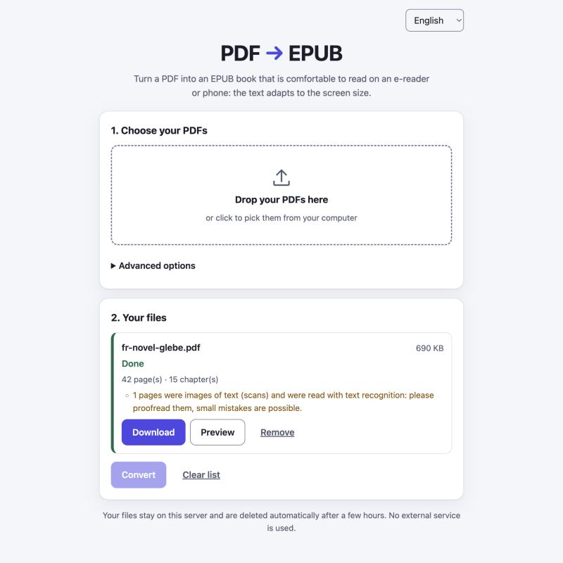
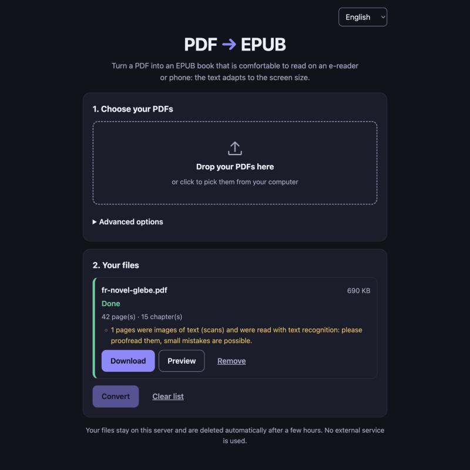
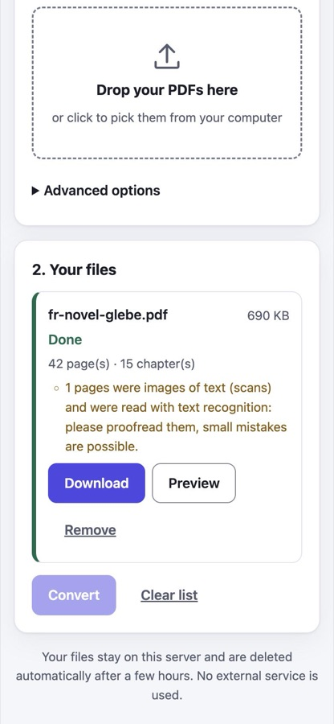

# pdftoepub

**Turn a PDF into a real e-book (EPUB) that adapts to any screen. Free, private, runs on your own computer.**
**Transformez un PDF en vrai livre numérique (EPUB) qui s'adapte à tous les écrans. Gratuit, privé, sur votre ordinateur.**

[](LICENSE)

The output contains real text (headings, paragraphs, lists, tables, images, footnotes), not page pictures, so it
reflows with the reader's font size on an e-reader or a phone. Scanned pages are read with built-in text recognition
(OCR, English and French). Nothing is sent to any external service.

<p align="center">
  
  
  
</p>

## Pour commencer

1. **Téléchargez** le fichier correspondant à votre ordinateur dans le tableau [Télécharger](#download--télécharger)
   (Mac : `.dmg` ; Windows : `.exe` ; Linux : le fichier `linux`).
2. **Mac :** ouvrez le `.dmg`, glissez `pdftoepub.app` dans Applications, puis double-cliquez dessus.
   **Windows :** double-cliquez sur le `.exe`. Rien d'autre à installer (ni Python, ni OCR).
3. Au premier lancement, le système affiche un avertissement car l'application n'est pas signée :
   voir [Premier lancement](#first-launch-of-an-unsigned-build--premier-lancement) (une seule fois).
4. Votre navigateur s'ouvre : déposez vos PDF, cliquez **Convertir**, puis **Télécharger**. Tout reste sur votre
   ordinateur. Pour arrêter, cliquez **Quitter** dans la page (sinon l'application s'arrête seule après 15 minutes
   sans utilisation).

## Getting started

1. **Download** the file for your computer from the [Download](#download--télécharger) table (Mac: `.dmg`;
   Windows: `.exe`; Linux: the `linux` file).
2. **Mac:** open the `.dmg`, drag `pdftoepub.app` to Applications, double-click it. **Windows:** double-click the
   `.exe`. Nothing else to install (no Python, OCR included).
3. The first launch shows a warning because the app is not signed: see
   [First launch](#first-launch-of-an-unsigned-build--premier-lancement) (once only).
4. Your browser opens: drop your PDFs, click **Convert**, then **Download**. Everything stays on your computer. To stop
   it, click **Quit** in the page (it also stops by itself after 15 minutes without use).

## Download / Télécharger

From the [latest release](https://github.com/ember169/pdftoepub/releases/latest)
(repository slug `ember169/pdftoepub`, to be confirmed; it is set in `packaging/release.sh`). Every file includes OCR
(Tesseract with English and French data) and checks against `SHA256SUMS`.

| System | File | Size | Minimum |
|---|---|---|---|
| Mac with Apple silicon (M1 and later) | `pdftoepub-macos-arm64.dmg` | 40 MB | macOS 12 Monterey |
| Mac with Intel processor | `pdftoepub-macos-x86_64.dmg` | 42 MB | macOS 12 Monterey |
| Mac, command line only | `pdftoepub-macos-arm64` / `pdftoepub-macos-x86_64` | 37 / 38 MB | macOS 12 |
| Windows | `pdftoepub-windows-x86_64.exe` | 88 MB | 64-bit Windows (tested under Wine only) |
| Linux (PC) | `pdftoepub-linux-x86_64` | 73 MB | glibc 2.31 (Debian 11, Ubuntu 20.04 or newer) |
| Linux (ARM) | `pdftoepub-linux-arm64` | 72 MB | same |

There is no single "universal" Mac file: pick by chip ( menu → About This Mac). The minimum macOS is measured on every
binary at build time (`packaging/audit_minos.sh`), not just declared; it was not tried on a real macOS 12 machine.

### First launch of an unsigned build / Premier lancement

The builds are **not signed** with an Apple or Microsoft certificate (that costs a yearly fee), so the system warns once.
This is expected; afterwards the app opens normally.

**macOS 15 Sequoia and newer** (the old right-click → Open shortcut no longer works):

1. Double-click `pdftoepub.app`. macOS shows *"pdftoepub" Not Opened — Apple could not verify "pdftoepub" is free of
   malware…*. Click **Done** (not *Move to Trash*).
2. Open **System Settings → Privacy & Security**, scroll down to *Security*: next to *"pdftoepub" was blocked to protect
   your Mac* click **Open Anyway**, confirm with **Open Anyway** and your password / Touch ID.
3. From now on, double-click opens it directly.

**macOS 12–14:** right-click (or Control-click) `pdftoepub.app` → **Open** → **Open**.

**Windows:** SmartScreen shows *Windows protected your PC*. Click **More info**, then **Run anyway**.

**Command-line files** (`pdftoepub-macos-*`): clear the download quarantine once in Terminal:
`xattr -d com.apple.quarantine pdftoepub-macos-arm64 && chmod +x pdftoepub-macos-arm64`
(for the app: `xattr -dr com.apple.quarantine /Applications/pdftoepub.app`).

> **Premier lancement (FR)** — les versions publiées ne sont pas signées par Apple/Microsoft, le système avertit une
> seule fois. **macOS 15 et plus récent :** double-cliquez sur `pdftoepub.app` ; au message *« pdftoepub » n'a pas été
> ouvert*, cliquez **Terminé** (pas *Placer dans la corbeille*). Ouvrez **Réglages Système → Confidentialité et
> sécurité**, descendez jusqu'à *Sécurité* et cliquez **Ouvrir quand même** à côté de *« pdftoepub » a été bloqué…*,
> puis confirmez (**Ouvrir quand même**, mot de passe ou Touch ID). **macOS 12–14 :** clic droit sur l'app → **Ouvrir**
> → **Ouvrir**. **Windows :** à l'écran *Windows a protégé votre ordinateur*, cliquez **Informations
> complémentaires** puis **Exécuter quand même**.

(Dialog wording is from current macOS/Windows releases and may differ slightly between versions.)

## Command line

Every download is also a command-line tool (on macOS the app's executable is
`/Applications/pdftoepub.app/Contents/MacOS/pdftoepub`):

```bash
./pdftoepub-linux-x86_64 book.pdf -o book.epub
./pdftoepub-linux-x86_64 serve --open        # web page on http://127.0.0.1:8000
./pdftoepub-linux-x86_64                     # no arguments: starts the web page and opens the browser
```

| CLI flag | Default | Meaning |
|---|---|---|
| `--title`, `--author` | from PDF metadata | Override metadata |
| `--language` | detected | BCP 47 code, e.g. `fr` |
| `--ocr` | `auto` | `auto` (pages without text), `off`, `force` |
| `--ocr-langs` | `fra+eng` | Tesseract languages |
| `--keep-headers-footers` | off | Keep running headers/footers and page numbers |
| `--no-columns` | off | Disable multi-column reading order |
| `--no-images` | off | Leave images out |
| `--timeout`, `--max-mem`, `--max-pages` | none | Stop conversions that take too long, too much memory or too many pages |

`pdftoepub --help` lists them all. The web page offers the same choices under *Advanced options*.

**OCR:** the binaries ship Tesseract (macOS 5.5.4 built from source, Windows 5.4, Linux 4.1) with `tessdata_fast`
English and French data (~5 MB; a bit less accurate on poor scans than `tessdata_best`, ~20 MB). Pages that are
pictures of text are recognised automatically and flagged in the result so you can proofread them.
`TESSERACT_CMD` / `TESSDATA_PREFIX` or a `tesseract/` folder next to the executable override the bundled copy.

**macOS launcher:** the first run unpacks ~100 MB into `~/Library/Caches/pdftoepub/` (about 15 s once, while macOS
scans the new files); after that a 2-page PDF converts in 0.3 s. Delete that folder to uninstall.

## Self-hosting (Docker)

```bash
docker compose -f deploy/docker-compose.yml up --build
```

Open <http://localhost:8000>. The compose file publishes the port on **127.0.0.1 only**. The container runs read-only,
as a non-root user, with a memory limit (`MEM_LIMIT`, default 2g), 256 pids and no capabilities; uploads and results
live in the `pdftoepub-data` volume and are deleted after `JOB_TTL_HOURS`. The image includes Tesseract (English,
French).

**Public hosting:** set `AUTH_TOKEN` (the page then asks for it), keep the localhost port mapping and put a TLS proxy in
front: [`deploy/Caddyfile.example`](deploy/Caddyfile.example) (disables SSE buffering, caps the body size). Set
`ALLOWED_HOSTS` to your domain. All server variables (`MAX_UPLOAD_MB`, `MAX_PAGES`, `JOB_TIMEOUT_S`, `JOB_MAX_MEM_MB`,
`MAX_CONCURRENT_JOBS`, …) are listed in [`src/pdftoepub/web/README.md`](src/pdftoepub/web/README.md).
`GET /healthz` serves health checks.

## Quality

Measured on 18 public-domain or openly licensed PDFs (3,362 pages: novels in English and French, arXiv papers, a
1,185-page textbook, math books, scanned Internet Archive books); details and method in
[`tests/corpus/REPORT.md`](tests/corpus/REPORT.md):

- **98.3 %** of the words found (running heads and page numbers are removed on purpose), **0.948** reading-order score
  (6-word sequences in the right order).
- **0 epubcheck errors** on all 18 books with both PDF backends.
- Scanned books get their chapters back from the page layout: 7/7 essays in Zola's *Le roman expérimental*, 3/3 in
  *An Island Plant*.
- Math books: two-dimensional formulas become pictures with a text alternative; mid-sentence paragraph breaks on
  *Calculus Made Easy* fell from 87 to 47 per 1000 paragraphs.

## Limits

- Max upload `MAX_UPLOAD_MB`; encrypted (password-protected) and non-PDF files are rejected.
- Layout analysis is heuristic: complex layouts (nested tables, magazines, marginal notes) may need manual cleanup.
- Math: no MathML. Two-dimensional display formulas become pictures (alt text = the formula as linear text);
  one-row formulas, sub/superscripts and inline fractions (`a/b`) stay text.
- Scanned books without a PDF outline: chapters are found from the page layout and a printed table of contents;
  titles keep their OCR misreads.
- Vector figures are rasterised; OCR quality depends on the scan and the chosen languages.
- One server process; no multi-node scaling.

## Website (planned)

A GitHub Pages site is planned at <https://ember169.github.io/pdftoepub/>: presentation, the download table,
screenshots and a FAQ on opening unsigned apps. Its sources will live in `docs/` (which already holds the screenshots;
the site's `index.html` is not created yet) and be published with the Pages "Deploy from a branch" setting (branch
`main`, folder `/docs`, the only sub-folder that setting can serve), with no GitHub Actions.

## Releases (built locally, no CI)

There is no CI: everything is built and tested on a Mac (Docker for Linux, Wine in Docker for Windows), then uploaded.

```bash
packaging/build.sh mac-arm64 mac-x86_64 linux-arm64 linux-x86_64 windows   # all binaries into dist/
packaging/smoke.sh                       # tests every binary in clean environments, rewrites dist/SHA256SUMS
packaging/release.sh v0.1.0              # dry run: checks dist/, writes SHA256SUMS, prints the gh command
packaging/release.sh v0.1.0 --publish    # creates the GitHub release (needs `gh auth login`)
```

- macOS needs `uv`, cmake and the Xcode command line tools. Run `packaging/build_tesseract_macos.sh` once first: it
  builds Tesseract, Leptonica and libpng from pinned, sha256-checked sources for both Mac chips (macOS 11+).
- The Intel Mac build runs under Rosetta and uses `packaging/macos-x86_64.lock`; Mac builds pin pypdfium2 5.9.0
  (newer PDFium needs macOS 13). The build fails if any binary needs a newer macOS than 12.0.
- Linux is built on Debian 11 in Docker and tested in clean `debian:11-slim` and `ubuntu:20.04` containers. Windows is
  built and tested under Wine, never on real Windows; `packaging/build.ps1` (native Windows) has never been run.
- Every dependency is installed from hash-pinned lock files (`requirements.lock`, `packaging/*.lock`;
  `packaging/relock.sh` regenerates them). The binaries contain no PyMuPDF (the build fails if it is present).

### Signing (ready, not used yet)

The current builds are ad-hoc signed. The scripts for real signatures are ready and were proven end to end with
throw-away self-signed certificates; they only need the certificates.

| | What removes the warning | Script |
|---|---|---|
| macOS | **Developer ID Application** certificate (Apple Developer Program, 99 USD/year) + notarization | `packaging/sign_macos.sh` (called by `build.sh`; hardened runtime, timestamp, notarize, staple) |
| Windows | **Authenticode** certificate (OV ~100–300 USD/year; EV or Azure Trusted Signing also possible) | `packaging/sign_windows.sh` (osslsigncode, RFC 3161 timestamp) |

```bash
xcrun notarytool store-credentials pdftoepub-notary --apple-id you@example.com --team-id TEAMID   # once
APPLE_SIGN_IDENTITY="Developer ID Application: Your Name (TEAMID)" APPLE_NOTARY_PROFILE=pdftoepub-notary \
  packaging/build.sh mac-arm64 mac-x86_64
WIN_SIGN_PFX=~/certs/codesign.pfx WIN_SIGN_PASSWORD=... packaging/sign_windows.sh
```

Verified with self-signed certificates: macOS `codesign --verify --deep --strict` OK, the signed app and CLI run and
OCR with no entitlement exceptions; Windows `osslsigncode verify` OK and the signed `.exe` runs under Wine.
Notarization needs Apple credentials and is untested.

## Development

```bash
python3.12 -m venv .venv && . .venv/bin/activate
pip install -e ".[dev]"
pdftoepub book.pdf -o book.epub          # CLI
pdftoepub serve                          # web page on :8000
pytest                                   # test PDFs are generated on the fly (tests/fixtures/make_fixtures.py)
docker build -f deploy/Dockerfile --target test -t pdftoepub-test . && docker run --rm pdftoepub-test   # + epubcheck
python tests/corpus/fetch.py             # real-world corpus (downloads, sha256-checked)
python tests/corpus/evaluate.py --label mine
```

From a source install, OCR needs `tesseract` and language packs (`brew install tesseract tesseract-lang`,
`apt install tesseract-ocr-fra`); without it scanned pages are skipped with a warning. epubcheck 5.4.0 is downloaded
once into `tests/.cache` (sha256-checked; `EPUBCHECK_JAR` to use your own) and its tests are skipped without `java`.
The suite runs once per PDF backend (`PDFTOEPUB_BACKEND` = `pdfminer`, `pymupdf`).

## License

MIT (see [`LICENSE`](LICENSE)). Default PDF backend: pdfminer.six (MIT) + pypdfium2 (Apache-2.0/BSD-3). The binaries
bundle Python (PSF), PDFium, Tesseract (Apache-2.0), Leptonica (BSD-2), libpng and `tessdata_fast` (Apache-2.0);
their licences are listed in `THIRD_PARTY_LICENSES` (also inside each binary).

An optional backend uses [PyMuPDF](https://pymupdf.readthedocs.io/) (`pip install ".[pymupdf]"`,
`PDFTOEPUB_BACKEND=pymupdf`). PyMuPDF is **AGPL-3.0**, so an installation that includes it falls under the AGPL. The
binaries and the Docker image do not include it.
