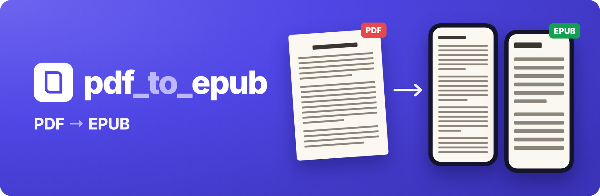

<p align="center">
  
</p>

<p align="center">
  <a href="https://github.com/ember169/pdf_to_epub/releases/latest"></a>
  <a href="https://github.com/ember169/pdf_to_epub/releases"></a>
  <a href="LICENSE"></a>
  
  <a href="deploy/docker-compose.yml"></a>
  
  <a href="tests/corpus/REPORT.md"></a>
</p>

<p align="center"><b><a href="#français">Français</a> · <a href="#english">English</a></b></p>

---

## Français

**pdf_to_epub transforme un PDF en livre EPUB dont le texte s'adapte à l'écran.** Pas des images de pages : du vrai
texte, qui suit la taille de police de votre liseuse ou de votre téléphone. Les livres scannés sont lus par OCR. Tout
se passe sur votre ordinateur.


### Fonctionnalités

- **Texte recomposable** : titres, paragraphes, listes, tableaux, images, liens, colonnes remises dans l'ordre.
- **Structure retrouvée** : chapitres et table des matières, depuis les signets du PDF, les titres ou le sommaire imprimé.
- **Notes reliées** : notes de bas de page et de fin de chapitre, avec retour au texte.
- **Livres scannés** : OCR intégré (français, anglais), correction des mots collés et des confusions courantes.
- **Couverture et métadonnées** : titre, auteurs, éditeur, ISBN, numéros de page imprimés.
- **Privé** : rien n'est envoyé en ligne. EPUB 3 valides et sans DRM.
- **Partout** : app Mac, Windows et Linux, ligne de commande, ou serveur Docker.

### Installation

Téléchargez le fichier de votre système dans la **[dernière version](https://github.com/ember169/pdf_to_epub/releases/latest)**.
Rien d'autre à installer : Python et l'OCR sont inclus.

| Système | Fichier |
|---|---|
| Mac, puce Apple (M1 et suivantes) | `…-macos-arm64.dmg` |
| Mac, Intel | `…-macos-x86_64.dmg` |
| Windows 64 bits | `…-windows-x86_64.exe` |
| Linux | `…-linux-x86_64` ou `…-linux-arm64` |

Sur Mac, ouvrez le `.dmg` et glissez l'app dans Applications ; sur Windows, lancez le `.exe`. Une page s'ouvre dans
votre navigateur : déposez vos PDF, cliquez **Convertir**, puis **Télécharger**.

<p align="center"></p>

<details>
<summary><b>Premier lancement : l'app n'est pas signée</b></summary>

Les versions ne sont pas signées par Apple ou Microsoft : le système prévient une seule fois.

- **macOS 15 et plus récent** : double-cliquez sur l'app, cliquez **Terminé**, puis ouvrez **Réglages Système →
  Confidentialité et sécurité** et cliquez **Ouvrir quand même**.
- **macOS 12 à 14** : clic droit sur l'app → **Ouvrir** → **Ouvrir**.
- **Windows** : **Informations complémentaires** → **Exécuter quand même**.
- **Fichiers en ligne de commande sur Mac** : `xattr -d com.apple.quarantine pdf_to_epub-macos-arm64 && chmod +x pdf_to_epub-macos-arm64`.

Sur Mac, le premier lancement décompresse environ 100 Mo dans `~/Library/Caches/pdftoepub/` ; supprimez ce dossier pour
désinstaller.
</details>

### Ligne de commande

Chaque fichier téléchargé est aussi un outil en ligne de commande, `pdftoepub` :

```bash
pdftoepub livre.pdf -o livre.epub           # conversion
pdftoepub scan.pdf --ocr force --ocr-langs fra
pdftoepub serve --open                      # l'interface web sur http://127.0.0.1:8000
```

`pdftoepub --help` liste toutes les options.

### Serveur (Docker)

```bash
docker compose -f deploy/docker-compose.yml up --build
```

Puis <http://localhost:8000>. Pour l'ouvrir au public, définissez `AUTH_TOKEN` et `ALLOWED_HOSTS` et placez un proxy
TLS devant ([configuration](src/pdftoepub/web/README.md)).

### Limites

- Les mises en page complexes (magazines, notes en marge) peuvent demander une retouche.
- Les formules en deux dimensions deviennent des images ; pas de MathML.
- Un scan garde quelques erreurs d'OCR ; les mots collés ne sont corrigés qu'en français et en anglais.
- La version Windows n'a été testée que sous émulateur.

La qualité est mesurée sur 18 PDF du domaine public : voir le [rapport](tests/corpus/REPORT.md).

### Contribuer

Issues et contributions bienvenues : voir [CONTRIBUTING.md](CONTRIBUTING.md). Ne joignez jamais un document protégé par
le droit d'auteur à une issue.

### Licence

[MIT](LICENSE). Les applications incluent des composants tiers sous leur propre licence (Tesseract, PDFium, listes de
mots wordfreq en CC BY-SA 4.0…), listés dans `THIRD_PARTY_LICENSES` avec chaque binaire. Le moteur optionnel PyMuPDF
est sous AGPL et n'est pas inclus dans les applications. Convertissez des documents que vous avez le droit d'utiliser.

---

## English

**pdf_to_epub turns a PDF into an EPUB book whose text adapts to the screen.** Not pictures of pages: real text that
follows the font size of your e-reader or phone. Scanned books are read with OCR. Everything happens on your computer.


### Features

- **Reflowable text**: headings, paragraphs, lists, tables, images, links, columns put back in reading order.
- **Structure recovered**: chapters and table of contents, from the PDF bookmarks, the headings or the printed contents.
- **Linked notes**: footnotes and chapter endnotes, with a link back to the text.
- **Scanned books**: built-in OCR (English, French), fixes for words run together and common misreads.
- **Cover and metadata**: title, authors, publisher, ISBN, printed page numbers.
- **Private**: nothing is sent online. Valid, DRM-free EPUB 3.
- **Everywhere**: Mac, Windows and Linux app, command line, or Docker server.

### Install

Download the file for your system from the **[latest release](https://github.com/ember169/pdf_to_epub/releases/latest)**.
Nothing else to install: Python and OCR are included.

| System | File |
|---|---|
| Mac, Apple silicon (M1 and later) | `…-macos-arm64.dmg` |
| Mac, Intel | `…-macos-x86_64.dmg` |
| Windows 64-bit | `…-windows-x86_64.exe` |
| Linux | `…-linux-x86_64` or `…-linux-arm64` |

On a Mac, open the `.dmg` and drag the app to Applications; on Windows, run the `.exe`. A page opens in your browser:
drop your PDFs, click **Convert**, then **Download**.

<p align="center"></p>

<details>
<summary><b>First launch: the app is not signed</b></summary>

The builds are not signed by Apple or Microsoft, so the system warns once.

- **macOS 15 and newer**: double-click the app, click **Done**, then open **System Settings → Privacy & Security** and
  click **Open Anyway**.
- **macOS 12–14**: right-click the app → **Open** → **Open**.
- **Windows**: **More info** → **Run anyway**.
- **Command-line files on a Mac**: `xattr -d com.apple.quarantine pdf_to_epub-macos-arm64 && chmod +x pdf_to_epub-macos-arm64`.

On a Mac the first launch unpacks about 100 MB into `~/Library/Caches/pdftoepub/`; delete that folder to uninstall.
</details>

### Command line

Every download is also a command-line tool, `pdftoepub`:

```bash
pdftoepub book.pdf -o book.epub             # convert
pdftoepub scan.pdf --ocr force --ocr-langs eng
pdftoepub serve --open                      # the web interface on http://127.0.0.1:8000
```

`pdftoepub --help` lists every option.

### Server (Docker)

```bash
docker compose -f deploy/docker-compose.yml up --build
```

Then <http://localhost:8000>. To open it to the public, set `AUTH_TOKEN` and `ALLOWED_HOSTS` and put a TLS proxy in
front ([configuration](src/pdftoepub/web/README.md)).

### Limits

- Complex layouts (magazines, marginal notes) may need touching up.
- Two-dimensional formulas become pictures; no MathML.
- A scan keeps some OCR mistakes; words run together are fixed in English and French only.
- The Windows build was only tested under an emulator.

Quality is measured on 18 public-domain PDFs: see the [report](tests/corpus/REPORT.md).

### Contributing

Issues and contributions are welcome: see [CONTRIBUTING.md](CONTRIBUTING.md). Never attach a copyrighted document to an
issue.

### License

[MIT](LICENSE). The apps include third-party components under their own licenses (Tesseract, PDFium, wordfreq word
lists under CC BY-SA 4.0…), listed in `THIRD_PARTY_LICENSES` next to every binary. The optional PyMuPDF backend is
AGPL and is not included in the apps. Convert documents you are entitled to use.
